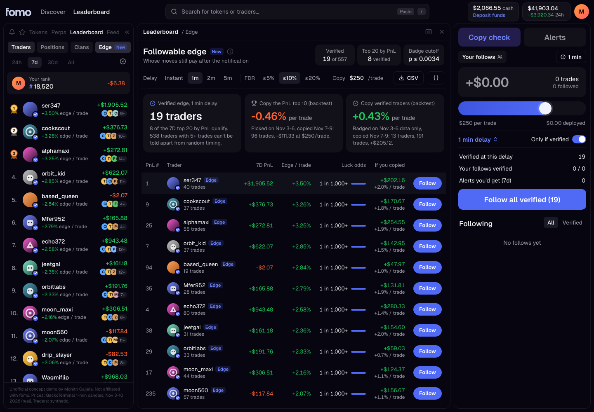

# Followable edge: a leaderboard badge for fomo that survives the notification delay

**Live demo:** https://mohith26.github.io/fomo-followable-edge/

fomo's leaderboard ranks everyone by realized and unrealized PnL, and following a trader gets you their buys and sells as notifications. But a follower never gets the trader's fill: they act a minute later, pay the trader's price impact on the way in and out, and pay fees on every copy. **Followable edge** adds an *Edge* tab to the leaderboard that answers one question per trader: *if I act on this person's notifications d minutes late, do their entries still beat random entries into the same tokens?* Each trader gets a calibrated "luck odds" (a permutation p-value against an activity-matched null), Benjamini-Hochberg turns those into an **Edge badge whose false-badge rate is capped at a target you choose (10% by default)**, and a copy check replays exactly what a follower would have made, on real 1-minute prices, with fomo's published fee schedule.



## Results (real prices, synthetic traders; `data/results.json`, `data/robustness.json`)

17 Solana/Base memecoins, real 1-minute candles from GeckoTerminal, Nov 3 to Nov 10 2026. 600 simulated traders (11,573 trades) placed on those real price paths: random-timing retail, momentum chasers, whales, a few informed swing traders, and snipers whose edge lives only in the first minute.

| Follower delay | Verified (of 557 with 5+ trades) | False badges vs. truth | Skilled traders found | Pure-luck traders badged | Backtest: copy PnL top 10 | Backtest: copy verified |
|---|---|---|---|---|---|---|
| Instant (bot) | 57 | 5.3% | 75% (incl. snipers) | 3 | -0.06% / trade | +0.86% / trade |
| **1 min** | **19** | **0.0%** | **41%** | **0** | **-0.46% / trade** | **+0.43% / trade** |
| 2 min | 17 | 5.9% | 35% | 1 | -0.27% / trade | +1.20% / trade |
| 5 min | 19 | 0.0% | 41% | 0 | -0.15% / trade | +1.64% / trade |

Backtest: traders picked using only Nov 3-6 data (PnL top 10, or Edge badges computed on Nov 3-6 trades), then every trade they opened Nov 7-9 copied at $250 per trade, d minutes late, with fomo's fee schedule and constant-product price impact.

* **Robustness:** re-running the whole simulation with 20 different trader seeds on the same prices, copying verified traders beat copying the PnL top 10 in **18 of 20** runs (mean +0.81% vs. 0.00% per trade), the realized false-badge rate averaged **3.9%** against a 10% target, and pure-luck traders badged averaged **0.75** per board.
* **Why activity matching matters:** a naive null that draws random entry times uniformly (ignoring when a token was actually trading) badges 35 traders at 1 minute, **9 of them pure luck** (26% false). Retail buys cluster in busy minutes, which are not random minutes.
* **Snipers:** 26 traders built to catch only the next minute are badged at "Instant" and lose the badge once a human-speed delay is applied, which is the point of making the badge delay-specific.
* **PnL is a weak guide:** only 8 of the 7D top 20 by PnL earn the badge at 1 minute.
* **Copy size matters:** at $100 per copy, Solana's $0.95 flat fee band costs ~1.9% per round trip and wipes out the edge (verified -0.34% / trade); the copy-size slider makes that visible.

## How it works

1. **Statistic.** For trader *i* and follower delay *d*: the mean log return of their trades with both legs shifted *d* minutes (`core/edge.js: delayedLogReturn`).
2. **Activity-matched null.** For each trade, a random entry minute is drawn inside the same fixed 12-hour block, with probability proportional to that token's traded volume in each minute (plus a small floor), keeping the token and the holding time. Blocks are fixed clock blocks, not windows centred on the real entry, so under H0 the real entry and the draws are exchangeable and the Monte Carlo p-value `(1 + #{null >= observed}) / (B + 1)` is exact (`permutationTest`, B = 999).
3. **False discovery control.** Benjamini-Hochberg over every trader with 5+ trades turns p-values into badges with FDR at most *q* (`benjaminiHochberg`, `verify`).
4. **Per-trade edge.** The exact activity-weighted expectation of the same trade under the null (`nullExpectation`, a sum over every admissible minute), so each row in the drill-down shows "trader return vs. random entry".
5. **Copy check.** A follower buys *d* minutes late after the trader's buy has moved a constant-product pool, sells after the trader's sell, pays their own impact and fomo's published fee (`followerNetReturn`, `feeRate`): Solana $0.10 / 2% / $0.95 flat / 0.50% bands, 0.50% on EVM chains.
6. **Backtest** (`backtest`): selection on days 1-4 only; a test scrambles every day 5-7 return and checks the selected sets do not change.

Heavy work (11k trades x 999 permutations x 4 delays) is precomputed by `scripts/generate.mjs` (~4 s); the app recomputes BH, copy sims and the backtest in the browser from `data/board.json` whenever you change the delay, FDR target or copy size.

## The app

The page rebuilds fomo web's shell (top bar, search with `/`, left panel with Tokens / Perps / Leaderboard / Feed tabs, Traders / Positions / Clans chips, 24h / 7d / 30d / All ranges, a TradingView-style chart with trade bubbles, and the right-hand order panel) with the feature placed as a new **Edge** tab on the leaderboard.

* **Main view** `#/`: Edge leaderboard, delay / FDR controls, backtest summary, CSV and JSON export.
* **Trader drill-down** `#/trader/<handle>?t=<trade>`: real candles around each trade with the trader's and your fills, per-trade table, the permutation null histogram ("Luck test"), and how the edge decays with delay.
* **Backtest** `#/backtest`: out-of-sample comparison with follower PnL curves and a ground-truth check (possible only because traders are synthetic).
* **Actions:** follow / unfollow (persisted in localStorage), "follow all verified", alerts-only-if-verified toggle, copy-size slider, export.
* **Keyboard:** `/` search, `j`/`k` move, `Enter` open, `Esc` back, `f` follow, `d` cycle delay, `v` verified only, `e` export CSV.
* URL state: `?d=1&q=10&c=250` deep-links every setting.

## Run it

```
node --test test/*.test.mjs        # 15 tests (CI workflow in ci/test.yml; move to .github/workflows/ to enable): p-value validity, FDR control, AMM math, fees, headline numbers
node scripts/generate.mjs          # rebuild data/board.json, data/results.json, data/prices/*.json
node scripts/robustness.mjs        # 20-seed robustness table
python3 -m http.server             # then open http://localhost:8000
```

`scripts/search_pools.mjs` and `scripts/fetch_ohlcv.mjs` re-download the pools and candles from GeckoTerminal's public API (raw snapshots are committed in `data/raw/`).

## Honest limitations

* **Traders are synthetic.** Prices, volumes and pool reserves are real; every trader, trade and handle is simulated (seeded). The skill mix and edge sizes are assumptions, chosen so that skilled traders are a small minority with modest edges; the numbers above say how the method behaves on that mix, not how many fomo traders are skilled.
* **Liquidity model.** Price impact uses each token's deepest pool reserve at download time as a constant-product depth for the whole week. fomo's router splits across pools, so real impact is probably lower; reserves also changed during the week.
* **1-minute resolution.** Delays below a minute (a bot copying in the same block) are approximated by "Instant" = same-minute close.
* **Timing skill only.** The null keeps the token, so it measures *when* someone buys, not *which* token they pick. Token-selection skill would need a second null that redraws the token among those trading at the time.
* **Power.** With one week of data and about 25 trades per skilled trader, the badge finds about 40% of genuinely skilled traders at 1 minute; it is built to be rarely wrong, not to find everyone. Longer windows (fomo has 30d and All) raise power.
* Fee schedule from fomo's help center (read Nov 11 2026); network gas and the 10% referral discount are not modelled.

## Prior art and novelty

* fomo's leaderboard (help.fomo.family "Leaderboard", "The Positions leaderboard", release notes Oct 26 2026) ranks by PnL; the help center states fomo has no copy-trading feature, and following gives notifications. No skill/luck or follower-delay metric is documented (checked help center, release notes Apr-Oct 2026, blog).
* Competitors: Kolscan and Solana Tracker rank wallets by PnL / ROI / win rate; Solana Tracker lists "Copy-Trade Performance: top wallets ranked by follower PnL" as *Soon*; Cielo shows a 0-100 "Copy score"; OKX ranks lead traders by a weighted mix of PnL%, drawdown and follower count. None publishes a calibrated luck test, a delay-specific badge, or a false-discovery guarantee.
* The statistics are standard (Monte Carlo permutation tests; Benjamini & Hochberg 1995); the contribution is the activity-matched, delay-shifted null for social trading and the delay-specific FDR-controlled badge.

Unofficial concept demo by Mohith Gajjela. Not affiliated with fomo. Price data: GeckoTerminal public API. Traders: synthetic.
